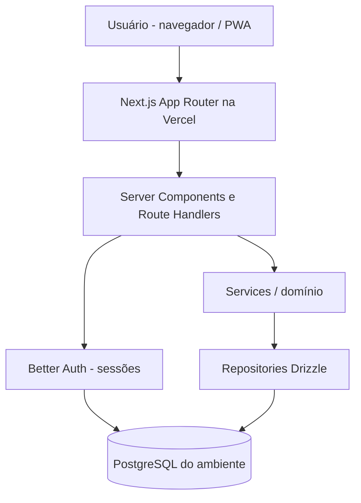

# RESET — Especificação completa do aplicativo

Compilação para leitura e revisão. Para implementação, use o pacote ZIP, que preserva os arquivos separados, `AGENTS.md`, `.env.example` e OpenAPI.

---

<!-- Fonte: README.md -->

# Reset — Spec-Driven Development (SDD)

**Status:** especificação inicial, proposta para implementação.  
**Data:** 2026-10-25  
**Idioma do produto:** pt-BR  
**Codinome:** Reset (provisório; validar disponibilidade de marca)  
**Plataforma:** Web app responsivo / PWA para hospedagem na Vercel.

> Produto próprio inspirado nas mecânicas gerais de acompanhamento de hábitos e gamificação do Life Reset, sem reutilizar marca, textos, imagens, telas ou conteúdo proprietário.

## O que este pacote entrega

| Ordem | Artefato | Uso |
|---|---|---|
| 1 | `specs/00-product.md` | Problema, público, histórias, escopo e métricas |
| 2 | `specs/01-experience.md` | Jornadas, telas, UX, design system e acessibilidade |
| 3 | `specs/02-architecture.md` | Stack, estrutura, limites arquiteturais |
| 4 | `specs/03-domain-model.md` | Entidades, persistência, regras e cálculos |
| 5 | `specs/04-auth-security.md` | Better Auth, autorização, privacidade e segurança |
| 6 | `specs/05-api.md` | Contratos HTTP e requisitos de validação |
| 7 | `contracts/openapi.yaml` | OpenAPI simplificado da API de domínio |
| 8 | `specs/06-acceptance.md` | Cenários verificáveis e estratégia de testes |
| 9 | `specs/07-implementation.md` | Slices verticais, dependências e Definition of Done |
| 10 | `specs/08-deploy.md` | Vercel, PostgreSQL, variáveis, CI e operação |
| 11 | `specs/09-decisions.md` | ADRs e decisões pendentes |
| 12 | `AGENTS.md` | Instruções para agente de implementação |
| 13 | `.env.example` | Nomes de variáveis sem credenciais |

## Princípio SDD

**Spec → critérios de aceite → teste → implementação → revisão.** Cada mudança de escopo começa na spec identificada por ID (`FR-*`, `BR-*`, `AC-*`). Não implementar uma funcionalidade só por parecer útil. Manter specs e código no mesmo PR.

## Execução sugerida

1. Aprovar as premissas em `specs/09-decisions.md`.
2. Criar repositório Next.js 16 + TypeScript e instalar dependências da stack.
3. Implementar os slices de `specs/07-implementation.md` em ordem.
4. Validar casos de `specs/06-acceptance.md` antes de marcar um slice como concluído.
5. Preparar ambientes preview e produção conforme `specs/08-deploy.md`.

**Não inclui:** código do aplicativo pronto nem banco provisionado; este é um pacote de especificações e contratos para orientar a construção.

## Fontes técnicas consultadas (25/10/2026)

- Next.js App Router e Proxy: https://nextjs.org/docs/app / https://nextjs.org/docs/app/api-reference/file-conventions/proxy
- Better Auth: https://better-auth.com/docs/installation / https://better-auth.com/docs/integrations/next / https://better-auth.com/docs/concepts/email
- Postgres na Vercel: https://vercel.com/docs/postgres
- Ambientes da Vercel: https://vercel.com/docs/deployments/environments
- Vercel Cron: https://vercel.com/docs/cron-jobs/usage-and-pricing
- Referência de produto (somente inspiração): https://play.google.com/store/apps/details?id=build.designand.riselife

**Nota de versões:** conferir release estável e avisos de segurança ao executar `pnpm install`; evitar betas e versões canary como padrão. Comportamento de Better Auth, Drizzle e provedores de e-mail deve ser validado no lockfile da implementação.

---

<!-- Fonte: AGENTS.md -->

# AGENTS.md — Regras para agente de implementação

Você é um engenheiro implementando o aplicativo Reset com spec-driven development. **Leia o README e as specs em ordem antes de criar código.**

## Regras mandatórias

1. Nunca inventar requisito de produto. Cite o `FR-*`/`BR-*`/`AC-*` que sua mudança atende.
2. Para cada tarefa, executar ciclo: **spec → plano de arquivos → testes → código mínimo → testes → revisão**.
3. Tratar `/specs` e `/contracts/openapi.yaml` como fonte de verdade. Propor e documentar conflito em ADR antes de desviar.
4. Não copiar branding, telas, textos ou assets do Life Reset. Criar identidade visual original.
5. Não usar serviços pagos sem justificar e pedir decisão; `Reset` é codinome.
6. Nunca marcar funcionalidade como pronta com mocks em runtime de produção.
7. Evitar `any`, `@ts-ignore` sem justificativa e TypeScript com erro.
8. Todos os inputs externos são validados por Zod; toda operação privada valida sessão no servidor e `userId` no acesso a dados.
9. Toda mutation de hábitos/jornada/conclusão tem teste de caso feliz, falha, autorização e concorrência quando relevante.
10. Usar transação DB em operações compostas; índice único como defesa primária contra duplicidade.
11. O calendário é baseado em timezone IANA do perfil; não usar UTC como calendário local.
12. Usar versões estáveis de Next.js, Better Auth e Drizzle. Consulte documentação correspondente às versões instaladas.
13. Não executar migration destrutiva contra banco de produção sem revisão.
14. Não commitar `.env.local`, senhas, API keys nem PII de testes.
15. Um PR deve atualizar a spec e anexar evidência de lint, typecheck, testes e build.

## Ao iniciar uma tarefa

Responda/registre:

- Tarefa (`T-*`) e requisitos afetados (`FR-*`, `BR-*`, `AC-*`).
- Comportamento esperado, inclusive erros e estado vazio.
- Arquivos impactados e migrações esperadas.
- Testes que falhariam antes do código.
- Dependências não concluídas.

## Ao encerrar

Entregue resumo do código alterado, comandos executados, resultados de teste, limitações, diferenças em relação à spec e próximo slice.

## Ordem de implementação

S0 Fundação → S1 Auth → S2 Onboarding → S3 Hoje/conclusão → S4 Hábitos → S5 Progresso/Diário → S6 Privacidade/PWA/Deploy.

## Regras específicas de módulos

- UI: RSC default, client apenas quando necessário; usar shadcn/ui e tokens.
- Application: serviços são responsáveis por transações e checagens de negócio.
- Domain: lógica pura testável; cálculos de streak, agenda e XP sem React.
- Infrastructure: Drizzle; nenhuma query sem escopo `userId` para recursos privados.
- API: contratos consistentes com OpenAPI, status e mensagens seguras.

---

<!-- Fonte: specs/00-product.md -->

# 00 — Product Requirements Document (PRD)

## Visão

O Reset é um aplicativo de hábitos que ajuda adultos a transformar metas abstratas em pequenas ações recorrentes. Um onboarding curto resulta em até três hábitos iniciais; a interface principal exibe apenas o que precisa ser feito hoje. O progresso é apresentado de maneira visual, com XP e sequências, sem culpabilizar interrupções.

## Problema

Pessoas tentam mudar hábitos sem clareza sobre ações diárias, abandonam aplicativos complexos ou perdem motivação quando falham um dia. A hipótese: reduzir o custo de registrar progresso e oferecer retorno imediato aumentará o retorno à aplicação e a consistência.

## Público inicial

- Adultos com rotina corrida que querem construir hábitos simples de saúde, foco, estudo, organização e bem-estar.
- Uso principal: smartphone; uso secundário: desktop.
- Idioma inicial: pt-BR. Região inicial: Brasil. Fuso por usuário.

## Proposta de valor

> Defina o que importa, cumpra pequenas missões no dia a dia e visualize a evolução da sua rotina.

## Métricas de produto (metas hipóteses, NÃO benchmarks)

- **Ativação:** >= 60% dos usuários cadastrados criam a jornada e concluem uma missão em até 24h.
- **Retenção D7:** >= 25% dos usuários ativados retornam no sétimo dia (coorte por data de ativação).
- **Conclusão semanal:** >= 50% de missões agendadas marcadas como concluídas nos primeiros 7 dias, excluindo usuários que cancelaram conta.
- **Tempo para registrar uma missão:** mediana <= 5 segundos a partir do dashboard.
- Dados coletados com consentimento quando analytics não essenciais forem habilitados; medir eventos agregados/pseudonimizados.

## Escopo

| ID | Funcionalidade | Prioridade | Regra de aceite resumida |
|---|---|---|---|
| FR-01 | Cadastro, login e logout | P0 | Cadastro cria sessão imediata gerenciada pelo Better Auth |
| FR-02 | Onboarding curto | P0 | Nome/objetivo/áreas/fuso + 1 a 3 hábitos iniciais |
| FR-03 | Jornada de 66 dias | P0 | Uma jornada ativa por usuário; dia calculado pelo calendário local |
| FR-04 | CRUD de hábitos | P0 | Criar, editar, arquivar e reativar; máximo de 5 ativos na primeira versão |
| FR-05 | Agenda de hoje | P0 | Apenas hábitos ativos previstos para a data local atual |
| FR-06 | Marcar/desmarcar conclusão | P0 | Operação idempotente sem duplicar pontos |
| FR-07 | XP e streak individual | P0 | XP calculado de conclusões válidas; sequência ignora dias não agendados |
| FR-08 | Dashboard e resumo semanal | P0 | Progresso previsto vs concluído e histórico de 7 dias |
| FR-09 | Diário opcional | P1 | Uma reflexão por dia local, humor 1 a 5, conteúdo privado |
| FR-10 | Perfil e preferências | P0 | Fuso, nome, exportação e exclusão da conta |
| FR-11 | PWA básica | P1 | Manifest, ícones próprios, instalação e página offline informativa |
| FR-12 | Acessibilidade | P0 | Teclado, contraste, foco, aria-label, redução de movimento |

## Fora do MVP

- IA generativa, coaching clínico, comunidade, compartilhamento público, ranking entre usuários, pagamento, anúncios, push, e-mail de lembretes recorrentes, cron jobs, Pomodoro, meditação, audiobooks.
- Offline-first real com fila de escrita/sincronização (PWA instalável **não** significa CRUD offline).
- App nativo (iOS/Android), internacionalização, múltiplas jornadas simultâneas, múltiplos perfis.

## Histórias principais

- **US-01:** Como visitante, quero cadastrar-me para salvar meus hábitos em segurança.
- **US-02:** Como novo usuário, quero configurar um objetivo e hábitos recomendados para começar rapidamente.
- **US-03:** Como usuário, quero marcar um hábito com um toque para acompanhar o progresso diário.
- **US-04:** Como usuário, quero ver streak e XP para sentir progresso sem depender de uma única sequência perfeita.
- **US-05:** Como usuário, quero editar uma agenda sem apagar meu histórico.
- **US-06:** Como usuário, quero ver progresso da semana sem cálculos manuais.
- **US-07:** Como usuário, quero corrigir uma marcação feita por engano.
- **US-08:** Como usuário, quero exportar e apagar meus dados.

## Política de onboarding

1. Tela de boas-vindas com proposta clara (sem promessas científicas de transformação obrigatória).
2. Escolha até 2 áreas: Saúde, Foco, Estudos, Organização, Bem-estar.
3. Escolha uma meta em texto curto (<= 120 caracteres) e um fuso horário IANA (sugerido pelo navegador).
4. Escolha de 1 a 3 hábitos de sugestões editáveis ou criados do zero.
5. Mostra resumo da jornada de 66 dias (prazo inspiracional, sem garantir mudança de comportamento).
6. Salva jornada + hábitos em transação e direciona ao Dashboard.

## Diretrizes de conteúdo

- Linguagem brasileira simples, sem termos moralizadores (“você falhou”, “perdeu tudo”).
- Recomendar continuidade com mensagens como “Retome hoje”.
- Não posicionar o app como tratamento médico, psicoterapia ou substituto de aconselhamento profissional.
- Não copiar marca, ilustrações ou textos do produto usado como referência.

## Telemetria mínima (consentimento e minimização)

Eventos possíveis: `account_created`, `onboarding_completed`, `habit_created`, `habit_completed`, `habit_uncompleted`, `journey_day_viewed`. Não registrar texto de meta, nome do hábito nem diário em eventos. Para MVP pode começar somente com logs técnicos, sem analytics de comportamento.

---

<!-- Fonte: specs/01-experience.md -->

# 01 — Experiência, telas e design system

## IA / navegação

- Público: `/` (landing), `/entrar`, `/cadastro`, `/privacidade`, `/termos`.
- Protegido: `/onboarding`, `/app` (Hoje), `/app/habitos`, `/app/progresso`, `/app/diario`, `/app/configuracoes`.
- Mobile: barra inferior com Hoje / Hábitos / Progresso / Diário; Configurações no avatar.
- Desktop: sidebar discreta com as mesmas seções.

## Fluxos

### Primeiro acesso

`Landing → Cadastro → sessão imediata → Onboarding (áreas → objetivo → hábitos) → Hoje`.
Cadastro cria a sessão e leva diretamente ao onboarding. Se sessão válida sem onboarding, redirecionar para onboarding. Se onboarding concluído, ir para Hoje.

### Missão diária

`Hoje → selecionar hábito pendente → confirmar (ação otimista com rollback em erro) → indicador XP e progresso atualizado → desfazer (reversão validada)`.
Não exibir mensagem de erro silenciosa. Pending e completed devem ser identificáveis sem depender apenas de cor.

### Replanejamento

`Hábitos → editar nome, emoji, agenda semanal ou arquivar → confirmação → agenda futura refletida`.
Alterar calendário não deve alterar completions históricas. Arquivar preserva histórico e impede novas missões.

## Layouts descritivos

### Tela “Hoje”, mobile (360 px)

```
┌─────────────────────────────────┐
│ Bom dia!                  avatar │
│ Dia 08 de 66                   │
│ █████░░░░░░░░  Jornada         │
│                                 │
│ Hoje: 2 de 3 concluídas         │
│ ┌─────────────────────────────┐ │
│ │ ○ Ler 10 minutos      +10 XP│ │
│ ├─────────────────────────────┤ │
│ │ ✓ Caminhar 15 min           │ │
│ ├─────────────────────────────┤ │
│ │ ✓ Organizar mesa            │ │
│ └─────────────────────────────┘ │
│                                 │
│ Pequenas ações, progresso real. │
│                                 │
│ Hoje Hábitos Progresso Diário   │
└─────────────────────────────────┘
```

### Progresso

- Card: total de XP da jornada.
- Card: consistência da semana = completions / missões previstas na janela × 100; se denominador 0, mostrar “Sem missões previstas” e não 100%.
- Gráfico de 7 dias com percentual de cumprimento (tooltip e tabela textual acessível).
- Lista de sequências por hábito; exibir 0 para hábitos sem sequência atual.

### Empty/error states

- Sem hábitos: “Vamos criar seu primeiro hábito” + CTA.
- Todos concluídos: “Você concluiu as missões de hoje” + resumo (sem confete obrigatório).
- Sem internet: mostrar informação sobre conexão e permitir leitura do conteúdo cacheado, sem prometer que gravações serão sincronizadas.
- Erro inesperado: mensagem recuperável + “Tentar novamente”.

## Design system — proposta inicial

**Conceito:** acolhedor, moderno, sem estética de jogo infantil. Incentivo visual discreto.

### Tokens (valor sugerido; validar contraste)

| Token | Claro | Escuro |
|---|---|---|
| `--background` | `#F8FAF8` | `#0F1714` |
| `--surface` | `#FFFFFF` | `#17231D` |
| `--foreground` | `#173025` | `#E9F4EC` |
| `--muted` | `#627568` | `#A7B9AD` |
| `--primary` | `#1C7653` | `#73D8A4` |
| `--primary-foreground` | `#FFFFFF` | `#092014` |
| `--accent` | `#E7BC69` | `#E7BC69` |
| `--danger` | `#B42318` | `#FCA5A5` |
| `--radius-card` | `16px` | `16px` |

- Fontes: `Geist Sans` ou `Inter` (via `next/font`, sem carregar Google Fonts via cliente).
- Escala de espaçamento: 4 / 8 / 12 / 16 / 24 / 32 px.
- Tamanho mínimo de toque: 44 × 44 px.
- Layout até 767px mobile, 768–1199 tablet, >=1200 desktop; max-width de conteúdo 1120px.
- Preferência por componentes shadcn/ui e tokens CSS; não duplicar primitives manualmente.
- Ícones Lucide; emoji de hábito com fallback textual.

## Biblioteca inicial de componentes

`AppShell`, `BottomNav`, `SidebarNav`, `PageHeader`, `ProgressRing`, `JourneyCounter`, `HabitCard`, `HabitCheckButton`, `HabitForm`, `HabitSchedulePicker`, `XpIndicator`, `StreakBadge`, `WeekCompletionChart`, `DailyReflectionForm`, `EmptyState`, `ConfirmDialog`, `ErrorMessage`, `Skeleton`, `Toast`.

## Comportamento

- Loading via skeleton; alterações de conclusão podem usar optimistic UI, mas reversão obrigatória em conflito/erro.
- Animações suaves 120–220ms e suporte a `prefers-reduced-motion`.
- Formulários: validação inline, rótulos persistentes e descrição de erro legível.
- Dark mode: P1; componentes devem nascer com tokens preparados.

## Acessibilidade (AC-UX)

- WCAG 2.2 AA como objetivo; contraste medido, não apenas presumido.
- Tab e Shift+Tab percorrem fluxos; foco visível; sem armadilha de teclado.
- `aria-live` moderado para feedback de conclusão; progresso e calendário com equivalentes textuais.
- Não usar apenas cor, emoji ou animação para comunicar sucesso/falha.
- Campos com `label`; erros associados via `aria-describedby`.

---

<!-- Fonte: specs/02-architecture.md -->

# 02 — Arquitetura técnica

## Decisão de stack

- **Next.js 16 estável**, App Router, TypeScript estrito, Node.js runtime nas rotas com Postgres.
- **React Server Components** por padrão; Client Components somente para formulário, gráfico interativo e estados otimistas.
- **Better Auth** para credenciais e sessão; nenhuma tabela de sessão custom. A V1 não verifica o e-mail nem envia recuperação de senha.
- **PostgreSQL gerenciado, provedor escolhido para Vercel**; **Drizzle ORM + drizzle-kit** para persistência e migrations. Não usar Neon.
- **Tailwind CSS + shadcn/ui**; **Zod** para schemas de entrada/saída; **React Hook Form** na UI.
- **Vitest + Testing Library** (unit/component) e **Playwright** (E2E).
- **pnpm**, ESLint, Prettier, GitHub Actions e Vercel Git Integration.
- PWA básica com manifest e service worker limitado a assets estáticos/offline fallback, sem cache de respostas privadas ou fila offline.

## Arquitetura geral



## Limites e fluxo de dependência

- `app/`: composição e roteamento; não contém cálculos complexos de domínio.
- `features/*/domain/`: regras puras, sem import de Next, banco ou UI.
- `features/*/application/`: casos de uso, validação de permissões e transações.
- `features/*/infrastructure/`: repositórios Drizzle, sem cálculo de XP/streak fora de domínio.
- `features/*/ui/`: componentes visuais, hooks e formulários.
- `lib/auth.ts`: configuração Better Auth no servidor; `lib/auth-client.ts` apenas cliente.
- `lib/db/*`: instância, schema, migrations.

`UI → handler/action → auth/validator → use-case → repository → database`.

## Estrutura proposta

```text
src/
  app/
    (marketing)/page.tsx
    (auth)/entrar/page.tsx
    (auth)/cadastro/page.tsx
    (protected)/onboarding/page.tsx
    (protected)/app/page.tsx
    (protected)/app/habitos/page.tsx
    (protected)/app/progresso/page.tsx
    (protected)/app/diario/page.tsx
    (protected)/app/configuracoes/page.tsx
    api/auth/[...all]/route.ts
    api/v1/habits/route.ts
    api/v1/habits/[id]/route.ts
    api/v1/habits/[id]/completions/route.ts
    api/v1/journey/route.ts
    api/v1/dashboard/route.ts
    api/v1/reflections/route.ts
    api/v1/me/export/route.ts
    api/v1/me/route.ts
    manifest.ts
  features/
    onboarding/{domain,application,infrastructure,ui}/
    habits/{domain,application,infrastructure,ui}/
    journey/{domain,application,infrastructure,ui}/
    progress/{domain,application,infrastructure,ui}/
    reflections/{domain,application,infrastructure,ui}/
    account/{domain,application,infrastructure,ui}/
  components/ui/
  lib/auth.ts
  lib/auth-client.ts
  lib/db/{index.ts,schema.ts,auth-schema.ts}/
  lib/http/{errors.ts,require-session.ts}/
  lib/time/local-date.ts
  styles/
tests/{unit,integration,e2e}/
proxy.ts
```

Nota: estrutura lógica, não criar diretórios vazios sem propósito; evitar uma pasta por classe.

## Convenções

- Exportações explícitas, modules pequenos, TypeScript `strict`.
- Zod na fronteira externa; tipos derivados das schemas.
- Datas de evento persistidas em UTC (`timestamptz`), datas de calendário locais em `DATE` (`YYYY-MM-DD`), timezones IANA.
- RSC/Route Handlers com dados por usuário **não cacheáveis publicamente**; usar `cache: 'no-store'` e/ou modo dinâmico quando aplicável, nunca reuso de resposta autenticada entre usuários.
- Preferir `GET` para consultas, `POST` para comandos de criação, `PATCH` para atualização e `DELETE` para remoção/desfazer.
- API interna versionada em `/api/v1`; usar Route Handlers para contratos HTTP e testes E2E. Não expor conexões do banco no cliente.
- Manter idempotência no banco via índices únicos e tratar conflitos no service.

## Autorização

`proxy.ts` pode redirecionar visitantes usando cookie como pré-checagem UX; **não substitui** `auth.api.getSession` em cada leitura/alteração protegida, nem a checagem de `userId` no repository. Consultar `specs/04-auth-security.md`.

## Observabilidade

- Logs estruturados `{requestId, route, latencyMs, statusCode}` sem PII e sem payloads privados.
- Indicadores: taxa de erro, latência p95, falhas de e-mail, tempo de consulta, taxa de 401/403.
- Erros tratados com `AppError` / `ApiError` e códigos estáveis.

## Não objetivos arquiteturais

- Nada de microserviços, event bus, Redis, cron ou filas no MVP.
- Não introduzir monorepo antes de existir uma segunda aplicação com necessidade real de compartilhamento.
- Nenhuma consulta sensível em cliente diretamente no banco PostgreSQL.

---

<!-- Fonte: specs/03-domain-model.md -->

# 03 — Modelo de domínio, dados e regras

## Modelo relacional

```mermaid
erDiagram
    USER ||--o| USER_PROFILE : possui
    USER ||--o{ JOURNEY : inicia
    USER ||--o{ HABIT : cria
    USER ||--o{ DAILY_REFLECTION : escreve
    JOURNEY ||--o{ HABIT : organiza
    HABIT ||--o{ HABIT_COMPLETION : recebe
    USER ||--o{ HABIT_COMPLETION : realiza
    USER { string id PK }
    USER_PROFILE { string user_id PK_FK string timezone string goal string onboarding_status }
    JOURNEY { uuid id PK string user_id FK date start_date date end_date string status }
    HABIT { uuid id PK uuid journey_id FK string user_id FK string title string schedule_days string status }
    HABIT_COMPLETION { uuid id PK uuid habit_id FK string user_id FK date local_date timestamptz completed_at }
    DAILY_REFLECTION { uuid id PK string user_id FK date local_date int mood string text }
```

A representação Mermaid resume as relações; detalhes e constraints abaixo prevalecem.

## Entidades propostas

### `user`, `session`, `account`, `verification`

Tabelas geradas pela CLI do Better Auth para a versão fixada. Não reimplementá-las nem assumir que IDs são UUID: o `user.id` é tratado como `text/string` até inspecionar o schema gerado.

### `user_profiles`

| Coluna | Tipo | Regra |
|---|---|---|
| `user_id` | text PK, FK -> `user.id` | cascade delete |
| `timezone` | text | IANA válido, default proposto `America/Sao_Paulo`, mas preferir browser |
| `goal` | varchar(120) | objetivo geral, nullable até onboarding |
| `focus_areas` | jsonb | array de até duas chaves do enum |
| `onboarding_completed_at` | timestamptz nullable | preenchido ao finalizar |
| `created_at`, `updated_at` | timestamptz | UTC |

### `journeys`

| Coluna | Tipo | Regra |
|---|---|---|
| `id` | uuid PK | gerado no servidor |
| `user_id` | text FK -> user | índice |
| `start_date`, `end_date` | date | `end_date = start_date + 65 dias` (66 dias inclusivos) |
| `status` | enum `active`, `completed`, `abandoned` | parcial único `(user_id) WHERE status = 'active'` |
| `created_at` | timestamptz | UTC |

Ao completar o dia 66 a jornada passa a `completed` numa leitura/mutação autorizada (sem cron necessário). Definir UX ao fim da jornada: resumo + opção de criar nova jornada; nenhuma nova jornada automaticamente.

### `habits`

| Coluna | Tipo | Regra |
|---|---|---|
| `id` | uuid PK | gerado no servidor |
| `user_id` | text FK -> user | escopo proprietário |
| `journey_id` | uuid FK -> journeys | mesma `user_id` obrigatória (service + teste) |
| `title` | varchar(80) | trim, 1..80 caracteres |
| `emoji` | varchar(16) | opcional, validar comprimento unicode |
| `status` | enum `active`, `archived` | soft archive; não apagar histórico |
| `created_at`, `updated_at`, `archived_at` | timestamptz | UTC |
| `archived_on` | date nullable | data local em que deixa de ser devido (inclusive) |

Índices em `(user_id, status)` e `(journey_id)`. Hábitos arquivados podem ser reativados respeitando limite de 5 ativos. Alterar agenda influencia **somente o calendário presente/futuro**, ver observação de histórico a seguir.

### `habit_schedule_versions` (necessária para consistência histórica)

| Coluna | Tipo | Regra |
|---|---|---|
| `id` | uuid PK | gerado no servidor |
| `habit_id` | uuid FK -> habits | cascade |
| `effective_from` | date | data local inicial da versão |
| `schedule_days` | smallint[] | conjunto 1..7 |
| `created_at` | timestamptz | UTC |

Versões são intervalos `[effective_from, próxima effective_from)`, índice único `(habit_id, effective_from)`. Criar uma versão inicial quando hábito é criado. Ao editar a agenda, uma nova versão começa **amanhã no fuso do usuário**, evitando alterar a obrigação do dia atual; em múltiplas edições, substituir versão futura na mesma data. Não permitir edição de datas históricas. A agenda devida de cada dia é determinada pela versão efetiva naquela data. **Fonte única de verdade:** `habit_schedule_versions`; não duplicar `schedule_days` em `habits`.

### `habit_completions`

| Coluna | Tipo | Regra |
|---|---|---|
| `id` | uuid PK | servidor |
| `user_id` | text FK -> user | escopo proprietário |
| `habit_id` | uuid FK -> habits | sem cascade físico para preservar histórico |
| `local_date` | date | data da missão no fuso do usuário |
| `completed_at` | timestamptz | UTC |

Unique `(habit_id, local_date)`. Não aceitar `user_id` no body. `habit.user_id` deve corresponder ao usuário da sessão. Conclusões só nos dias **agendados**, dentro da jornada e no dia local atual (MVP). Requisições concorrentes repetidas devem resultar em uma única linha. `DELETE` do mesmo registro é idempotente.

### `daily_reflections`

| Coluna | Tipo | Regra |
|---|---|---|
| `id` | uuid PK | servidor |
| `user_id` | text FK -> user | escopo proprietário |
| `local_date` | date | hoje no fuso do usuário |
| `mood` | smallint | 1..5 |
| `text` | varchar(500) | opcional, sanitizar saída contra XSS |
| `created_at`, `updated_at` | timestamptz | UTC |

Unique `(user_id, local_date)`; `PUT` faz upsert.

## Regras de domínio (BR)

- **BR-01:** uma jornada `active` no máximo; onboarding cria jornada e hábitos atomicamente.
- **BR-02:** start day = data local do início, dia 1; `dayIndex = clamp(diffCalendarDays(todayLocal, start_date)+1, 1, 66)` quando no intervalo; `daysRemaining = max(0, diffCalendarDays(end_date,todayLocal))` + UX apropriada.
- **BR-03:** hoje é calculado no servidor pelo fuso IANA salvo; **não** usar `toISOString().slice(0,10)` para determinar dia do usuário.
- **BR-04:** missão de hoje = hábito ativo + versão de agenda válida + dia da semana agendado + jornada em andamento.
- **BR-05:** `POST completion` e `DELETE completion` só para `local_date = hojeLocal` em MVP; não há edição de dia anterior, evitando backfill não auditado.
- **BR-06:** XP = `10 × número de completions válidas na jornada`; calculado de dados reais, sem contador mutável. Remover conclusão revoga 10 XP. Nenhum bônus adicional no MVP.
- **BR-07:** streak por hábito = número de **ocorrências agendadas consecutivas** concluídas retroativamente. Se a ocorrência de hoje está pendente, iniciar a contagem da ocorrência agendada anterior; nunca penalizar dias sem agendamento. Se a ocorrência agendada passada mais recente não foi concluída, streak atual = 0. Não atravessar início de jornada.
- **BR-08:** consistência = completions válidas / missões devidas no intervalo; histórico usa versão vigente por data. Sem missões devidas => `null`, UI “Sem missões previstas”.
- **BR-09:** `archived` impede novas conclusões. Histórico de datas locais **anteriores** ao dia local do arquivamento deve permanecer computável. Persistir `archived_on` (`DATE` calculada no fuso do usuário no momento do arquivamento) além de `archived_at` (UTC). A data local do arquivamento não entra como obrigação devida. Na primeira versão, “reativar” cria um **novo hábito com novo ID** e referência opcional ao anterior, preservando histórico e simplificando períodos de atividade.
- **BR-10:** fuso só poderá ser alterado no início do dia local seguinte (effective_from) ou após mensagem clara de que dados anteriores preservam as datas locais já registradas; mudanças não convertem datas históricas.
- **BR-11:** não retroceder XP ou missões de outros usuários; toda leitura/escrita filtra por `user_id` da sessão.

## Precisão de calendário

- Usar biblioteca compatível com IANA, por exemplo `date-fns` + `date-fns-tz` ou `Temporal` com polyfill validado.
- Nunca assumir dia de 24h em cálculos de calendário (horário de verão).
- Testar `America/Sao_Paulo`, `America/New_York` e `Pacific/Auckland`, viradas e alterações de timezone.

## Invariantes de integridade

- IDs imutáveis; `user_id` vem sempre da sessão.
- Índice único de conclusão evita XP duplicado.
- Unique parcial da jornada previne dois onboardings concorrentes.
- Retenção de histórico de hábito arquivado; exclusão total de usuário aciona workflow de deleção verificável (não deixar FKs impedirem exclusão).
- Transações para criação de jornada/hábitos e alteração de agenda.

## Observações que devem ser decididas antes da implementação

- Definir se exclusão de conta apaga também logs de telemetria pseudônimos; o padrão é excluir/anonimizar dentro da política de retenção documentada.
- Se suportarmos “pausar e reativar o mesmo hábito” depois, será necessário versionar períodos de ativação. MVP permite **arquivar** e “Criar novamente” com novo ID.

---

<!-- Fonte: specs/04-auth-security.md -->

# 04 — Identidade, autorização, segurança e privacidade

## Better Auth

Usar a **versão estável fixada por lockfile** e configurar as tabelas geradas pela CLI correspondente. Não misturar APIs da documentação de versões beta com a estável. Exemplo ilustrativo de inicialização — confirmar tipos e assinatura na versão instalada:

```ts
// src/lib/auth.ts (esboço de integração, não substituir por código sem validar)
import { betterAuth } from "better-auth";
import { drizzleAdapter } from "better-auth/adapters/drizzle";
import { db } from "@/lib/db";

export const auth = betterAuth({
  database: drizzleAdapter(db, { provider: "pg" }),
  emailAndPassword: {
    enabled: true,
    requireEmailVerification: false,
    autoSignIn: true,
  },
});
```

Handler oficial:

```ts
// src/app/api/auth/[...all]/route.ts
import { auth } from "@/lib/auth";
import { toNextJsHandler } from "better-auth/next-js";
export const { GET, POST } = toNextJsHandler(auth);
```

Exemplo de segurança por request:

```ts
import { auth } from "@/lib/auth";
import { headers } from "next/headers";

export async function getAuthenticatedUserId(): Promise<string> {
  const session = await auth.api.getSession({ headers: await headers() });
  if (!session) throw new Error("UNAUTHORIZED");
  return session.user.id;
}
```

Converter o erro no boundary HTTP para `401` estável; não retornar stack trace. Nos Route Handlers, passar os headers corretos da request à API do Better Auth.

## Estratégia de autenticação (AC-AUTH)

- Cadastro e login com e-mail + senha; cadastro cria sessão imediatamente. Google OAuth P1, não configurar sem credenciais.
- V1 não exige confirmação do e-mail e não oferece recuperação de senha por e-mail.
- Logout invalida sessão. Política de sessão e expiração explícitas conforme documentação da versão instalada.
- Autenticação em `app` não é autorização em `api`: `proxy.ts` pode redirecionar, mas cada Route Handler e cada Server Action deve validar sessão.
- Não usar `getSessionCookie()` sozinho para autorizar: só verifica existência de cookie.
- Se autenticação for disparada por Server Actions, verificar o plugin `nextCookies`; usando diretamente o cliente Better Auth e handler `/api/auth/*` a estratégia de cookies é gerenciada pelo próprio fluxo HTTP.

## Controles obrigatórios

| Controle | Especificação |
|---|---|
| IDOR | `habitId`, `journeyId`, `reflectionId` sempre consultados junto com `user_id = session.user.id` |
| Input | Zod no servidor para todos os payloads, limites de tamanho e enums |
| Rate limit | Aplicar a signup/login com recursos do Better Auth e, se necessário, mecanismo compartilhado; limites por IP/identidade, não memória por instância |
| CSRF | Manter proteções internas do Better Auth e restrições de origem; nunca desabilitar verificação indiscriminadamente |
| XSS | Escapar renderização de conteúdo do usuário; texto do diário sem HTML rico |
| Cookies | Secure em HTTPS, HttpOnly e SameSite conforme Better Auth; não guardar token em localStorage |
| Segredos | Somente variáveis server-side (sem prefixo `NEXT_PUBLIC_`) |
| HTTPS | Domínio de produção com TLS administrado pela Vercel |
| SQL | Query builder parametrizado do Drizzle; sem string interpolation de SQL |
| Auditoria | Logs técnicos com requestId e motivo de recusa; nunca logar senha, token ou diário |
| Headers | CSP e outros headers adequados após testes com shadcn/Next; sem bloquear autenticação |
| Dependências | Atualizar releases estáveis corrigidos e rodar auditoria CI |

## Privacidade e LGPD

- **Minimização:** e-mail, nome, configurações de hábito, metas, log de conclusão e reflexões opcionais. Não solicitar dados de saúde sensíveis.
- **Base legal e avisos:** política de privacidade e termos, informar finalidade, retenção, fornecedor de banco/serviços e contatos.
- **Exportar:** endpoint autenticado retorna JSON com dados de domínio da pessoa, em arquivo para download; não incluir senhas, segredos nem tokens de sessão.
- **Excluir conta:** fluxo com confirmação explícita e **reautenticação recente**; deleção de dados de domínio e identidade/autenticação; logs necessários com política de retenção documentada.
- **Reflexões:** privadas por padrão; não expor em analytics nem logs, nem utilizar para publicidade.
- **Consentimento:** analytics não essenciais desativados até existir consentimento granular.
- Revisar requisitos legais reais antes da abertura ao público; documento técnico não substitui revisão jurídica.

## Ameaças que testes devem cobrir

1. Usuário A tenta buscar/completar hábito B → `404` (não vazar existência) e sem alteração.
2. Cookie de sessão fabricado → não obtém dados privados.
3. Duplo clique / requisições simultâneas → só uma conclusão e 10 XP.
4. Reenvio de token de reset usado → rejeitado.
5. Payload com HTML/script no nome/meta/reflexão → apresentado como texto, nunca executado.
6. Alteração de timezone para manipular marcação em datas anteriores → impossível pelo contrato do MVP.

## Referências

- https://better-auth.com/docs/integrations/next
- https://better-auth.com/docs/concepts/email
- https://nextjs.org/docs/app/guides/authentication

---

<!-- Fonte: specs/05-api.md -->

# 05 — Contratos HTTP do MVP

Base: `/api/v1`. Auth é tratada pelo Better Auth em `/api/auth/[...all]` (não duplicar endpoints de login custom).

## Convenções

- **Autorização:** todas as rotas abaixo exigem sessão válida.
- **Content-Type:** `application/json; charset=utf-8`. Datas de calendário `YYYY-MM-DD`; instantes ISO 8601 UTC.
- **Resposta de sucesso:** `{ "data": ... }`. **Erro:** `{ "error": { "code": "CODE", "message": "Texto seguro", "requestId": "..." } }`.
- **Status:** `200` sucesso idempotente/leitura, `201` criação, `400` formato, `401` sem sessão, `403` ação proibida, `404` não pertence/existe, `409` conflito de negócio, `422` validação semântica, `429` rate limit, `500` inesperado.
- IDs de domínio: UUID. `userId` vem **exclusivamente** da sessão. Limite de payload geral 16 KB, exportação fora desse limite.
- Endpoints POST repetíveis usam índice único + operação idempotente. Não confiar só em bloqueio de botão frontend.

## Rotas

| Método | Rota | Body / Query | Resposta |
|---|---|---|---|
| `GET` | `/me` | — | profile, onboardingCompleted |
| `PATCH` | `/me` | `{name?, timezone?}` | profile atualizado |
| `GET` | `/me/export` | — | download JSON dos próprios dados |
| `POST` | `/api/auth/delete-user` | `{password}` (Better Auth); a interface exige confirmação textual explícita | exclusão após reautenticação por senha válida |
| `GET` | `/journey` | — | jornada ativa, dia atual e meta |
| `POST` | `/journey` | `{goal, focusAreas, timezone, habits:[...]}` | jornada e hábitos (onboarding atômico) |
| `GET` | `/habits` | `?includeArchived=true` opcional | lista ordenada, inclusive streak |
| `POST` | `/habits` | `{title,emoji?,scheduleDays}` | hábito criado na jornada ativa |
| `PATCH` | `/habits/{habitId}` | `{title?,emoji?,scheduleDays?}` | hábito atualizado, agenda só a partir de amanhã |
| `DELETE` | `/habits/{habitId}` | — | arquiva (soft delete) |
| `POST` | `/habits/{habitId}/completions/today` | `{}` | `{completed:true,xpDelta:0\|10,...}` |
| `DELETE` | `/habits/{habitId}/completions/today` | — | `{completed:false,xpDelta:0\|-10,...}` |
| `GET` | `/dashboard` | — | missões de hoje + métricas da jornada + últimos 7 dias |
| `GET` | `/reflections/today` | — | reflexão de hoje ou null |
| `PUT` | `/reflections/today` | `{mood,text?}` | reflexão salva por upsert |
| `DELETE` | `/reflections/today` | — | remove reflexão de hoje |

## Contratos de entrada

### POST `/journey`

```json
{
  "goal": "Ler mais e dormir melhor",
  "focusAreas": ["studies", "wellbeing"],
  "timezone": "America/Sao_Paulo",
  "habits": [
    { "title": "Ler 10 minutos", "emoji": "📚", "scheduleDays": [1,2,3,4,5,6,7] },
    { "title": "Alongar", "emoji": "🧘", "scheduleDays": [1,3,5] }
  ]
}
```

Regras: `goal` 1..120, `focusAreas` 1..2 sem repetição, `habits` 1..3, título 1..80, `scheduleDays` subconjunto não vazio de 1..7 sem repetição, fuso IANA validado. Retornar `409 JOURNEY_ALREADY_ACTIVE` se já ativada, sem criar novos hábitos.

### POST `/habits/{habitId}/completions/today`

```json
{
  "data": {
    "habitId": "55555555-5555-4555-8555-555555555555",
    "localDate": "2026-10-25",
    "completed": true,
    "xpDelta": 10
  }
}
```

Em repetição, status 200 com `xpDelta: 0`. Caso não seja dia agendado: `409 HABIT_NOT_SCHEDULED`. Caso não tenha jornada ativa: `409 NO_ACTIVE_JOURNEY`. Não aceitar `localDate` do cliente para conclusão, nem atualizações retroativas.

### GET `/dashboard`

```json
{
  "data": {
    "localDate": "2026-10-25",
    "journey": { "day": 8, "durationDays": 66, "status": "active", "totalXp": 90 },
    "today": { "scheduled": 3, "completed": 2, "habits": [] },
    "week": { "scheduled": 20, "completed": 12, "completionRate": 0.6, "days": [] },
    "streaks": [{ "habitId": "55555555-5555-4555-8555-555555555555", "count": 4 }]
  }
}
```

`completionRate = null` quando `scheduled = 0`. A API nunca expõe e-mail de terceiros ou conteúdos de reflexões nessa resposta.

## Consistência do erro

```json
{ "error": { "code": "HABIT_NOT_FOUND", "message": "Hábito não encontrado.", "requestId": "req_abc" } }
```

Todo handler mantém mapeamento determinístico erro→HTTP, com logs internos desvinculados da mensagem pública.

## Estratégia de schemas e contratos

- `src/features/*/application/schemas.ts` com Zod compartilhável sem importar server.
- `contracts/openapi.yaml` é o contrato de referência; diferenças devem falhar CI por testes/validação.
- Testes de contrato verificam autenticação, status, campos e resposta para cada rota.

---

<!-- Fonte: specs/06-acceptance.md -->

# 06 — Critérios de aceite e plano de testes

## Definition of Test Coverage

Todo requisito P0 tem: (1) cenário de aceite automatizável, (2) teste de unidade para regra, (3) teste de integração com banco real/isolado para índices e autorização quando aplicável, (4) E2E para fluxo essencial.

## Cenários de aceite (`AC-*`)

### AC-01 — Cadastro e onboarding (`FR-01`,`FR-02`,`FR-03`)

**Dado** que estou sem conta, **quando** cadastro-me com e-mail e senha válidos, **então** minha sessão é criada e sou redirecionado ao onboarding sem confirmação de e-mail. **Quando** informo objetivo e dois hábitos válidos, **então** uma jornada e dois hábitos são persistidos, e visualizo o dashboard.

**Erro:** cadastro inválido não cria jornada; tentativa concorrente de finalizar onboarding não cria duas jornadas.

### AC-02 — Missão diária (`FR-05`,`FR-06`)

**Dado** um hábito previsto para hoje, **quando** marco concluir, **então** passa a concluído e XP aumenta 10. **Quando** clico novamente/repito POST, **então** XP não aumenta de novo. **Quando** desfaço, XP retorna ao valor anterior; repetir DELETE não altera mais nada.

### AC-03 — Agenda customizada (`FR-04`,`FR-05`)

**Dado** hábito agendado seg/qua/sex, **quando** acesso terça, **então** ele não aparece como missão devida. **Quando** altero agendamento terça-feira, **então** a alteração vale a partir da quarta (ou próximo dia), sem reescrever métricas passadas.

### AC-04 — Timezones (`FR-03`,`FR-05`)

**Dado** dois usuários com fusos diferentes no mesmo instante UTC, **quando** consultam Hoje, **então** cada um vê sua data local correta e missões apropriadas. Virada de horário de verão não duplica nem elimina data de calendário.

### AC-05 — Streak (`FR-07`)

**Dado** um hábito previsto seg/qua/sex, com seg e qua concluídos, **quando** consulto quinta, **então** streak é 2, pois quinta não era devida. **Quando** deixo sexta passar sem conclusão, **então** no sábado streak é 0. Um hábito previsto diariamente e ainda pendente hoje mantém streak de ontem até o encerramento do dia local.

### AC-06 — Progresso semanal (`FR-08`)

**Dado** 6 missões devidas nos 7 últimos dias com 3 concluídas, **quando** consulto progresso, **então** vejo 50%. Se nenhuma missão estava prevista, mostro “Sem missões previstas”, não 100%.

### AC-07 — Isolamento (`FR-01`..`FR-10`)

**Dado** usuário A autenticado, **quando** tenta consultar ou completar recurso do usuário B por ID, **então** recebe 404 e não lê nem altera B. Sem sessão recebe 401.

### AC-08 — Arquivamento (`FR-04`)

**Dado** um hábito com histórico, **quando** o arquivo, **então** sai das missões futuras, mas histórico e XP já atribuídos permanecem. Criar novo hábito com o mesmo título não altera histórico do antigo.

### AC-09 — Reflexão (`FR-09`)

**Dado** usuário autenticado, **quando** registro humor 4 e comentário, **então** consigo editar a reflexão de hoje. Outro usuário não pode visualizar o conteúdo.

### AC-10 — Dados pessoais (`FR-10`)

**Dado** minha conta autenticada, **quando** exporto meus dados, **então** obtenho JSON sem tokens/senhas; **quando** solicito exclusão, devo confirmar e provar autenticação recente, e o sistema remove meus dados do domínio conforme política.

### AC-11 — Acessibilidade (`FR-12`)

Login, onboarding, criar hábito e concluir missão são operáveis só com teclado e leitor de tela básico; sem controles acessíveis apenas por cor.

### AC-12 — Falhas e recuperação

Falha na rede ao concluir hábito gera rollback do estado otimista e mensagem clara. Reenvio após reconexão conclui uma vez, sem duplicar XP.

### AC-13 — PWA e privacidade offline (`FR-11`)

**Dado** o service worker ativo e o aparelho sem conexão, **quando** navego para uma página, **então** vejo o fallback informativo. Respostas de `/api/*`, `/app*` e `/onboarding*` nunca são gravadas no cache; o produto não promete escrita offline.

### AC-14 — Health check de operação (`T-604`)

**Dado** o ambiente com `DATABASE_URL` válida, **quando** consulto `/api/health`, **então** recebo `200` sem dados internos; se o banco estiver indisponível, recebo `503` sem credenciais ou detalhes da exceção.

## Plano de execução de testes

| Tipo | Ferramenta | Onde |
|---|---|---|
| Unitários | Vitest | calendário, streak, XP, schema Zod |
| Componentes | Testing Library | formulários, cards, vazio, erros e a11y |
| Integração | Vitest + Postgres isolado | constraints, transações, consultas por proprietário |
| E2E | Playwright | auth → onboarding → hábito → completar → dashboard |
| Segurança | Testes HTTP | 401/404/409, validações, ataque de IDOR |
| Acessibilidade | axe + teste manual | telas críticas e teclado |
| Performance | Lighthouse CI e instrumentação | LCP/INP/CLS, mobile com rede lenta |

## Critérios de qualidade de release (propostos)

- TypeScript sem erros; lint, tests e build aprovados.
- Cobertura >= 85% das funções **puras de domínio** (não usar percentual global como proxy de qualidade).
- 100% dos cenários críticos `AC-01`, `AC-02`, `AC-04`, `AC-07`, `AC-10` passam na suíte de release.
- Lighthouse mobile nas telas públicas >= 90 em Accessibility; performance monitorada sem gate irreal para hardware variado.
- Nenhum segredo no bundle, logs ou repositório.
- Documentação de migração e rollback do deploy.

## Dataset de QA

Criar contas independentes A/B, data perto da meia-noite em UTC, agendas diárias e seg/qua/sex, duas requisições concorrentes e 66 dias de calendário incluindo viradas de mês. Banco de testes efêmero. Não usar dados pessoais reais nos fixtures.

---

<!-- Fonte: specs/07-implementation.md -->

# 07 — Plano de execução em slices verticais

Cada slice precisa resultar em comportamento navegável e testável, não apenas componentes isolados. A lista abaixo define **ordem e dependências**, não estimativas de calendário.

## S0 — Fundação (bloqueante)

- [ ] `T-001` Criar Next.js 16 App Router, pnpm, TS strict, Tailwind/shadcn, ESLint, Prettier.
- [ ] `T-002` Configurar Drizzle + PostgreSQL por ambiente, migrations versionadas e script de seed de testes. O provedor do ambiente Vercel permanece a escolher; Neon está excluído.
- [ ] `T-003` Criar CI (`lint`, `typecheck`, `test`, `build`) e preview Vercel.
- [ ] `T-004` Criar AppShell, tokens, EmptyState, ErrorBoundary, loading e layout mobile.
- [ ] `T-005` Preparar testes e mocks de clock/timezone.

**Gate S0:** build limpo; preview carrega landing; migration repetível a partir de banco vazio.

## S1 — Auth essencial

Estado da implementação (26/10/2026): Better Auth, schema Drizzle gerado, cadastro com acesso imediato, login, logout e proteção server-side por sessão estão implementados. A V1 não inclui confirmação de e-mail nem recuperação de senha. A aplicação está publicada na Vercel e conectada ao Supabase; ainda falta aplicar as migrations de produção e validar o fluxo com o banco.

- [ ] `T-101` Configurar Better Auth + schema gerado + adapter Drizzle.
- [ ] `T-102` Signup cria sessão imediatamente; signin/logout por e-mail e senha.
- [ ] `T-103` Proteger rotas, server actions e handlers por sessão validada.
- [ ] `T-104` Testes de sessão expirada, cookie inválido e usuário autenticado sem confirmação de e-mail.

**Gate S1:** `AC-01` (parte auth) e `AC-07` (auth) passam.

## S2 — Onboarding e jornada

Estado da implementação (26/10/2026): formulário responsivo em três etapas, validação Zod, criação transacional do perfil/jornada/hábitos, lock da conta para submissões simultâneas, índice parcial de jornada ativa, GET/POST `/api/v1/journey` e primeira tela Hoje com dados persistidos. A migration `0001_faithful_jack_power.sql` foi gerada, mas não aplicada. Testes com banco e submissões concorrentes reais ainda dependem de `DATABASE_URL` de desenvolvimento.

- [ ] `T-201` Models e migração de `user_profiles`, `journeys`, `habits`, `habit_schedule_versions`.
- [ ] `T-202` Fluxo de onboarding com Zod.
- [ ] `T-203` Criar jornada+hábitos atomicamente com unique parcial de jornada ativa.
- [ ] `T-204` Redirect de usuário sem onboarding e testes multi-submit.

**Gate S2:** novo usuário chega a Hoje com jornada e hábitos; `AC-01` passa integralmente.

## S3 — Core diário

- [ ] `T-301` Serviço `getLocalDate(timezone)`, agenda aplicável, missões diárias.
- [ ] `T-302` Tabela de completions + constraint unique.
- [ ] `T-303` POST/DELETE de conclusão idempotentes.
- [ ] `T-304` Dashboard Hoje com estados loading/empty/success/error.
- [ ] `T-305` Testes de concorrência, datas e autorização.

**Gate S3:** `AC-02`, `AC-04`, `AC-07`, `AC-12` passam.

Estado do S3 (26/10/2026): schema e migration de conclusões, validação de agenda pelo fuso do perfil, endpoints idempotentes de conclusão, leitura do dashboard diário e interface otimista com rollback estão implementados. O solicitante adiou execução de testes para o Vercel; integração com a base e validação dos critérios do gate permanecem pendentes.

Estado do S4 (26/10/2026): listagem, criação com limite de cinco hábitos ativos, edição com nova versão de agenda a partir de amanhã e arquivamento preservando histórico estão implementados com escopo por usuário e UI acessível. A validação de API, concorrência e fluxo completo está pendente para o ambiente Vercel conforme solicitado.

## S4 — Gerenciamento de hábitos

- [ ] `T-401` Listagem + CRUD (máx. 5 ativos).
- [ ] `T-402` Nova versão de agenda com vigência amanhã.
- [ ] `T-403` Arquivar e preservar histórico.
- [ ] `T-404` Testar históricos após editar agenda/arquivar.

**Gate S4:** `AC-03` e `AC-08` passam.

## S5 — Gamificação, analytics internos e diário

- [ ] `T-501` Funções puras de streak e XP.
- [ ] `T-502` Progresso semanal com denominador histórico correto.
- [ ] `T-503` Tela Progresso com gráfico acessível.
- [ ] `T-504` Reflexão diária opcional com upsert; cuidado com privacidade.

Estado do S5 (26/10/2026): XP, cálculo de consistência semanal com versões de agenda e dias de arquivamento, streaks por ocorrência prevista, resumo visual acessível e diário privado por data local com edição e exclusão estão implementados. Validação de persistência, autorização e concorrência será feita no ambiente Vercel, conforme solicitado.

**Gate S5:** `AC-05`, `AC-06`, `AC-09` passam.

## S6 — Perfil, privacidade, PWA e produção

- [ ] `T-601` Perfil, exportação e fluxo seguro de exclusão.
- [ ] `T-602` Termos, privacidade, manifest, ícones e offline fallback.
- [ ] `T-603` Testes E2E end-to-end, axe, revisão UX e segurança.
- [ ] `T-604` Recurso de monitoramento, alertas, DB production separado e runbook de rollback.
- [ ] `T-605` Deploy produção em domínio HTTPS e smoke tests.

**Gate S6:** `AC-10`, `AC-11`, runbook e release checklist completos.

Estado parcial do S6 (26/10/2026): perfil (nome e fuso), exportação JSON sem credenciais, exclusão confirmada com senha pelo endpoint nativo do Better Auth, páginas iniciais de privacidade/termos e PWA com fallback offline estão implementados no código. O service worker é restrito a arquivos estáticos e não intercepta API, onboarding ou páginas privadas para cache. Também foram adicionados `GET /api/health`, headers HTTP básicos e um runbook/checklist de operação Vercel. O projeto `reset` foi publicado na Vercel e conectado ao projeto Supabase `reset`; a integração sincroniza as variáveis do banco em Production. O segredo Better Auth e a URL pública estão configurados em Production. Migrations de produção, ambientes Preview/Development, validação AC-10, instalação, acessibilidade, headers, alertas e smoke tests permanecem pendentes. A V1 não usa envio de e-mail de autenticação. O aviso público ainda declara pendentes a identificação/contato do controlador e retenção de backups; por isso, não é documento final para lançamento.

## Definition of Done por tarefa

1. Contrato e regra alterados na spec antes ou junto da implementação.
2. Código tipado, validação Zod e checagem de dono/autorização feitas no servidor.
3. Testes do caso feliz e dos principais erros passam.
4. Caso apresente UI: estado carregando, vazio, erro, acessibilidade e mobile testados.
5. Migração reversível ou estratégia explícita de restauração registrada.
6. Verificação CI + preview; revisão de diff sem dados sensíveis.

## Priorização de riscos

1. **R1:** autorização com IDs de recurso — testar antes de liberar CRUD.
2. **R2:** cálculo de data local — construir serviço e testes em S0/S3, não espalhar `new Date()` nos componentes.
3. **R3:** consistência do histórico ao editar agenda — versionar antes de implementar relatório.
4. **R4:** exclusão de dados e FKs Better Auth — desenhar e testar em banco isolado antes do go-live.

---

<!-- Fonte: specs/08-deploy.md -->

# 08 — Deploy, infraestrutura e operação

## Infraestrutura alvo

- 1 projeto Next.js na Vercel (produção + previews de PR).
- 1 projeto PostgreSQL de produção no Supabase, conectado ao projeto Vercel existente pela integração oficial; o banco de desenvolvimento/preview separado ainda precisa ser configurado. Neon está excluído.
- DNS / domínio de produto próprio e TLS em produção.
- GitHub Actions valida o repositório; a integração Vercel cuida do deploy.

> O projeto Supabase existente `reset` foi conectado ao projeto Vercel `reset`. A integração sincroniza variáveis do Supabase no ambiente Production; Preview e Development ainda não estão configurados. Não usar Neon.

## Ambientes

| Ambiente | Uso | Banco | URL/Auth |
|---|---|---|---|
| Local | desenvolvimento | banco de dev | `http://localhost:3000` |
| Preview | QA por PR | banco isolado / branch de teste | URL de preview permitida explicitamente no Better Auth |
| Production | usuários reais | banco de produção | domínio canônico HTTPS |

**Importante:** URLs efêmeras de preview podem exigir configuração de `BETTER_AUTH_URL` e trusted origins por ambiente. Não definir coringas amplos para produção; verificar configuração da versão estável instalada.

## Variáveis sugeridas

| Variável | Quem usa | Observação |
|---|---|---|
| `DATABASE_URL` | Server | URL PostgreSQL adequada ao runtime; o código também aceita `POSTGRES_URL`/`POSTGRES_PRISMA_URL` da integração Supabase–Vercel |
| `DATABASE_URL_DIRECT` | Migrations | opcional; pode usar `POSTGRES_URL_NON_POOLING` sincronizada pela integração para schema changes |
| `BETTER_AUTH_SECRET` | Server | segredo longo gerado criptograficamente |
| `BETTER_AUTH_URL` | Server | URL absoluta da origem da app por ambiente |
| `BETTER_AUTH_TRUSTED_ORIGINS` | Server | se necessário, lista explícita de origens |
| `NEXT_PUBLIC_APP_URL` | Client/public | apenas URL pública, nunca credenciais |

O `.env.example` contém placeholders e deve ser copiado localmente para `.env.local`; `.env.local` não deve entrar no Git. No deploy, configurar no dashboard Vercel por ambiente.

## Processo de migração

1. Antes de aplicar em produção, gerar migration Drizzle versionada em commit.
2. Rodar checks e integração contra um banco de teste limpo.
3. Revisar SQL gerado e compatibilidade com dados existentes.
4. Aplicar migrations em produção em job **controlado**, antes de promover release que depende da alteração.
5. Preferir estratégia expand-and-contract, especialmente para mudança destrutiva.
6. Não usar `drizzle-kit push` automaticamente em produção nem atrelar migration destrutiva ao build de cada preview.

## Pipeline sugerido

PR → `pnpm install --frozen-lockfile` → `pnpm lint` → `pnpm typecheck` → `pnpm test` → `pnpm build` → preview Vercel → smoke/E2E no preview → review → merge → migration aprovada → deploy production → smoke.

Script package.json sugerido (a implementar): `dev`, `build`, `start`, `lint`, `typecheck`, `test`, `test:e2e`, `db:generate`, `db:migrate`, `db:studio`.

## Segurança de produção

- Environment variables em Vercel, rotacionar segredo comprometido, mínimo privilégio no provedor PostgreSQL escolhido.
- Proteção de preview se houver dados reais (preferir jamais conectar preview à base prod).
- Backup/PITR e retenção configurados conforme plano e fornecedor, com teste de restauração.
- Logs sem PII, alertas para picos 5xx, falhas de e-mail e lentidão.
- Rate limit não-local se expuser endpoints a abuso; recursos do Better Auth para auth.
- Revisar advisories de Next.js, Better Auth, Drizzle e driver de banco em todo release.

## PWA

- `src/app/manifest.ts`, ícones 192/512 e apple touch icon próprios.
- Offline: mostrar fallback informativo; páginas privadas não precisam ser salvas em cache compartilhado.
- Não afirmar que o usuário consegue marcar hábito offline. Sincronização offline será projeto separado.

## Cron e notificações

Nenhuma rotina periódica é necessária para calcular Hoje, streak ou fim da jornada; tudo pode ser calculado na requisição e estado concluído normalizado ao acesso. Se forem criados lembretes futuros, considerar job/queue por fuso. Na Vercel Hobby, cron é limitado a uma execução por dia, com precisão horária; não usar para lembretes pontuais por usuário.

## Runbook básico

1. Incidente P1: desabilitar release pelo rollback Vercel, confirmar compatibilidade da migration e restaurar banco somente com procedimento aprovado.
2. E-mail de autenticação: não utilizado na V1.
3. Banco indisponível: retornar 503 de maneira controlada; não tentar gravar localmente na função serverless.
4. Falha de autenticação após deploy: checar `BETTER_AUTH_URL`, trusted origins, cookies, DNS e variáveis do ambiente.

## Fontes

- https://vercel.com/docs/frameworks/full-stack/nextjs
- https://vercel.com/docs/postgres
- https://vercel.com/docs/deployments/environments
- https://vercel.com/docs/cron-jobs/usage-and-pricing

---

<!-- Fonte: specs/09-decisions.md -->

# 09 — Decisões arquiteturais (ADR) e premissas

As decisões listadas em “aprovada” são **recomendações da especificação**. Devem ser revisadas antes do código; não representam concordância explícita do solicitante.

| ADR | Decisão proposta | Motivo | Alternativa / efeito |
|---|---|---|---|
| ADR-001 | Next.js 16 App Router em Vercel | alinhamento full-stack e deploy | separar API depois, se necessário |
| ADR-002 | Better Auth | controle sobre identidade + integração com Next | Auth.js, Clerk |
| ADR-003 | Drizzle + PostgreSQL no Supabase existente, conectado à Vercel pela integração oficial | tipagem, migrations e reutilização do projeto Supabase criado pelo solicitante; Neon excluído | banco separado para Preview/Development ainda pendente |
| ADR-004 | Monólito modular | baixa complexidade operacional | microsserviços prematuros |
| ADR-005 | PWA responsiva antes de app nativo | entrega rápida e um único código | Expo/React Native fase 2 |
| ADR-006 | 66 dias como jornada orientativa | narrativa clara sem fazer promessa científica | 30/90 dias configuráveis futuramente |
| ADR-007 | XP derivado do log de completions | evita inconsistência e fraude de contador | ledger se surgirem compras/bonificações |
| ADR-008 | Edição de agenda só a partir de amanhã | mantém indicadores históricos reproduzíveis | agendamento retroativo com auditoria |
| ADR-009 | Sem assinatura no MVP | descobrir retenção e uso antes de monetizar | billing após validação |
| ADR-010 | Até cinco hábitos ativos | reduz complexidade e carga cognitiva | limite configurável futuramente |

## Decisões ainda abertas

- **D-01 Branding:** o nome “Reset” é somente codinome. Pesquisar domínio, marca e definir identidade antes do lançamento.
- **D-02 Monetização:** se e quando inserir plano premium; não implementado inicialmente.
- **D-03 E-mail:** escolher fornecedor e comprovar entregabilidade em domínio próprio.
- **D-04 Dados:** política de retenção de backups e prazo para exclusão, com revisão jurídica LGPD.
- **D-05 Analytics:** escolher solução e implementar consentimento antes de instrumentação não essencial.
- **D-06 Prazo e equipe:** roadmap é sequência técnica, não estimativa.
- **D-07 Google OAuth:** desejável na próxima iteração, fora da definição P0.
- **D-08 Habits:** regra atual de reativação = novo ID; caso haja expectativa de pausar/reativar mantendo mesmo ID, versionar também status temporal antes do desenvolvimento de S4.

## Não objetivos de negócio

Não garantir consolidação de hábitos em 66 dias, melhora clínica, perda de peso, aumento de produtividade mensurável, nem recompensas financeiras vinculadas a XP.

## Rastreabilidade

Uma alteração da regra “Dia atual” requer atualização de BR-03, API Dashboard, cenários AC-04 e testes de integração. Mudança de agenda requer BR-04, BR-08, AC-03 e migrations quando aplicável. Mudanças de auth exigem revisão do threat model e fluxo de deploy.

---

<!-- Fonte: specs/10-agent-prompt.md -->

# 10 — Prompt inicial para implementar com agente de programação

Cole a instrução abaixo em um agente de código dentro do repositório que contenha este pacote:

---

Você vai desenvolver um aplicativo chamado temporariamente Reset usando Spec-Driven Development.

1. Leia `README.md`, `AGENTS.md`, `specs/00-product.md` até `specs/09-decisions.md` e `contracts/openapi.yaml`.
2. Não comece a implementar todas as features de uma vez. Execute apenas **S0 — Fundação** de `specs/07-implementation.md`.
3. Primeiro escreva um plano com: requisitos impactados, estrutura dos arquivos, dependências, riscos e comandos de validação.
4. Implemente Next.js 16 estável com App Router/TS strict, Tailwind + shadcn, pnpm, Drizzle + PostgreSQL (sem requerer conexão para rodar lint/typecheck), Vitest/Playwright, CI e uma landing/estrutura básica responsiva.
5. Nunca cole credenciais. Forneça `.env.example`, ignore `.env.local` e evite migrations em produção.
6. Rode `pnpm lint`, `pnpm typecheck`, `pnpm test` e `pnpm build`. Se estiver sem credenciais, identifique os testes de integração bloqueados sem fingir sucesso.
7. Entregue resumo de arquivos alterados, resultados dos testes, decisões e o próximo slice. Pare ao concluir S0 para revisão.

Restrição: os textos, imagens, ícones proprietários e branding do Life Reset não podem ser copiados. Use a especificação como contrato, não como sugestão opcional.

---

## Prompt para próximos slices

“Leia o estado atual do repositório, `AGENTS.md` e as specs. Execute somente o slice **S[N]** do plano, incluindo testes dos `AC-*` ligados às tarefas. Não avance para o slice seguinte. No fim, mostre evidências de verificação, divergências e ajustes de spec necessários.”
